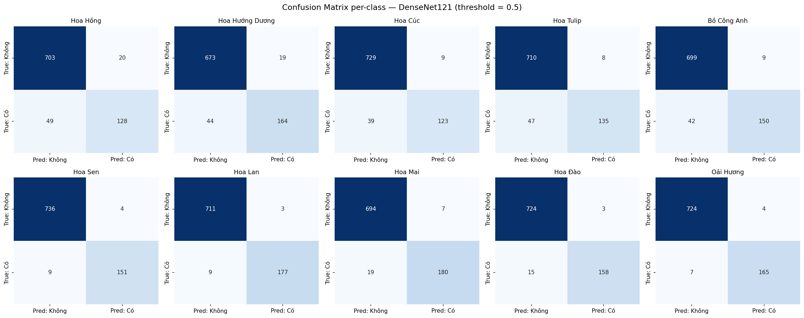
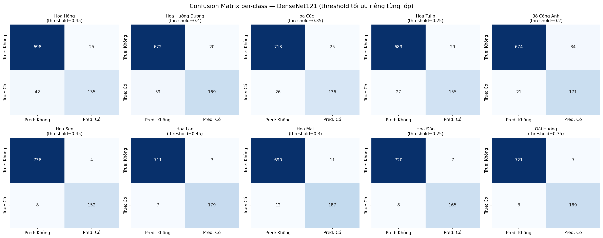

# Báo cáo Tuần 4 — Đánh giá mô hình & Xây dựng Backend

**Đồ án:** Hệ thống AI nhận diện đa nhãn loại hoa và gợi ý chăm sóc
**Tuần:** 4/5 — Đánh giá mô hình + Xây dựng Backend

---

## 1. Bổ sung Confusion Matrix per-class (góp ý báo cáo Tuần 3)

Theo góp ý của giáo viên sau báo cáo tuần 3, bổ sung ma trận nhầm lẫn (confusion matrix) cho mô hình DenseNet121 đã chọn. Vì bài toán là phân loại **đa nhãn** (multi-label), không thể dùng một ma trận N×N thông thường — sử dụng `sklearn.metrics.multilabel_confusion_matrix` để tạo 10 ma trận 2×2 riêng biệt (TN/FP/FN/TP) cho từng loại hoa.

### 1.1. Confusion matrix với threshold mặc định (0.5)



| Lớp | TN | FP | FN | TP |
|---|---|---|---|---|
| Hoa Hồng | 703 | 20 | 49 | 128 |
| Hoa Hướng Dương | 673 | 19 | 44 | 164 |
| Hoa Cúc | 729 | 9 | 39 | 123 |
| Hoa Tulip | 710 | 8 | 47 | 135 |
| Bồ Công Anh | 699 | 9 | 42 | 150 |
| Hoa Sen | 736 | 4 | 9 | 151 |
| Hoa Lan | 711 | 3 | 9 | 177 |
| Hoa Mai | 694 | 7 | 19 | 180 |
| Hoa Đào | 724 | 3 | 15 | 158 |
| Oải Hương | 724 | 4 | 7 | 165 |

**Nhận xét:** FN (bỏ sót) tập trung nhiều ở 5 lớp có dataset gốc lớn (Hoa Hồng, Hướng Dương, Cúc, Tulip, Bồ Công Anh — FN 39–49), trong khi 5 lớp tự thu thập ít ảnh hơn (Sen, Lan, Mai, Đào, Oải Hương) lại có FN rất thấp (7–19). Ngược lại FP hầu như không đáng kể ở mọi lớp — mô hình rất ít khi báo nhầm "có" khi thực tế "không", nhưng lại có xu hướng bỏ sót (báo "không" khi thực tế "có") nhiều hơn ở nhóm 5 lớp đầu.

### 1.2. Confusion matrix sau khi tối ưu threshold riêng từng lớp



So với bản threshold 0.5, threshold tối ưu (mục 3) làm giảm rõ rệt FN ở nhóm 5 lớp yếu (vd Bồ Công Anh: FN từ 42 → 21; Hoa Cúc: FN từ 39 → 26), đổi lại FP tăng nhẹ ở một số lớp — đúng như kỳ vọng khi hạ threshold để tăng Recall.

---

## 2. Công việc đã hoàn thành

### 2.1. Đánh giá mô hình DenseNet121 trên tập test (`notebooks/04_evaluate_model.ipynb`)

- Nạp model đã chọn từ tuần 3 (`models/final/flower_multilabel_model.keras`), chạy dự đoán trên 900 ảnh tập test.
- Phát hiện và xử lý lỗi tiền xử lý: lần chạy đầu tiên cho kết quả bất thường (chỉ 53/9000 giá trị xác suất vượt 0.5). Nguyên nhân là `preprocess_input` của DenseNet đã được nhúng sẵn thành layer bên trong model (xác nhận qua `model.summary()`: `true_divide → add → true_divide` ngay sau input), nhưng notebook đánh giá lại gọi thêm `preprocess_input()` ở bước tiền xử lý ngoài, khiến ảnh bị chuẩn hóa 2 lần. Đã sửa bằng cách bỏ bước chuẩn hóa ngoài, chỉ resize và giữ nguyên pixel [0, 255]. Sau khi sửa, Precision/Recall tổng tính tay khớp chính xác với `tuan3.md` (0.9468/0.8454), xác nhận đánh giá đúng.
- Vẽ confusion matrix per-class cho cả threshold mặc định (0.5) và threshold tối ưu (mục 1).
- Tính Precision/Recall/F1-score riêng từng lớp (per-class) trên tập test.
- Quét threshold trên tập validation (900 ảnh, không dùng tập test để tránh lộ đề) để tìm ngưỡng tối ưu riêng cho từng loại hoa, theo tiêu chí F1 cao nhất mỗi lớp.
- Áp threshold tối ưu vào tập test, đánh giá lại và so sánh với kết quả threshold mặc định.
- Cập nhật `models/comparison/model_comparison.json`: bổ sung kết quả đánh giá per-class + threshold tối ưu vào riêng entry `densenet121` (không đụng 4 model còn lại, đúng nguyên tắc chỉ mô hình được chọn mới trải qua bước này — xem mục 4).
- Copy `model_comparison.json` và `thresholds.json` sang `backend/`.

### 2.2. Xây dựng Backend Flask (`backend/`)

- Soạn code trực tiếp trong Colab bằng `%%writefile`, ghi vào đúng cấu trúc thư mục `backend/` trên Google Drive theo khung blueprint mục 3.
- Tạo `care_guide.json`: hướng dẫn chăm sóc đầy đủ 10 loại hoa × 5 trường (`anh_sang`, `nuoc_tuoi`, `dat_trong`, `nhiet_do`, `luu_y`), có validate tự động khi tạo để đảm bảo không thiếu/rỗng trường nào (CON-11).
- Tạo `model_loader.py`: nạp model, `classes.json`, `thresholds.json`, `care_guide.json` — dùng cơ chế cache để chỉ đọc/nạp 1 lần duy nhất khi khởi động server (NFR-05), không load lại mỗi request. `get_care_guide()` tự validate đủ 10 loại × 5 trường, raise lỗi rõ ràng nếu thiếu (EF-05) thay vì trả dữ liệu rỗng/giả.
- Tạo `predict.py`: tách riêng `validate_image()` (kiểm tra định dạng JPEG/PNG — FR-02) và `preprocess_image()` (resize 224×224×3, giữ nguyên thang pixel [0, 255] vì model tự xử lý chuẩn hóa bên trong). Hàm `predict_flowers()` thực hiện luồng suy luận → áp ngưỡng riêng từng lớp → ghép `care_guide`, trả về danh sách đã sắp theo confidence giảm dần.
- Tạo `app.py`: cài đặt đúng 2 endpoint theo CON-07.
  - `POST /predict`: kiểm tra file tồn tại → kiểm tra định dạng → validate ảnh thực → lưu tạm vào `static/uploads/` → suy luận → xóa file tạm → trả JSON. Xử lý đủ các trường hợp lỗi: thiếu file (400), sai định dạng (400), vượt kích thước (413), lỗi cấu hình model/dữ liệu (500), không phát hiện hoa nào (200 kèm message rỗng — FR-08).
  - `GET /models/comparison`: đọc và trả về `model_comparison.json`, báo lỗi 500 nếu file thiếu (EF-06).
  - Giới hạn kích thước file tải lên: **8MB** (chốt trong khoảng 5–10MB SRS đề xuất — NFR-07).
  - Tích hợp `flask-cors` để frontend (chạy origin/port khác ở tuần 5) gọi được API mà không bị trình duyệt chặn.
- Tạo `requirements.txt` khớp đúng version cài trên máy: `flask==3.1.3`, `flask-cors==6.0.5`, `tensorflow==2.20.0`, `pillow==11.3.0`, `numpy==2.1.3`.

### 2.3. Cài đặt và kiểm thử trên máy cục bộ

- Tải `backend/`, `models/final/`, `data/metadata/` về máy (Windows, Python 3.13.15) qua Google Drive for Desktop.
- Tạo virtual environment (`venv`), cài đặt `requirements.txt` (gặp timeout khi tải gói TensorFlow ~332MB do mạng chậm, xử lý bằng cách tăng `--default-timeout` và số lần retry).
- Chạy server thành công: `python app.py` → model nạp đúng 1 lần khi khởi động, server lắng nghe tại `http://localhost:5000`.

---

## 3. Kết quả kiểm thử

### 3.1. Luồng thành công (`POST /predict`)

Test với ảnh `aug_composite_00077.jpg` (nhãn thật: `hoa_huong_duong`, tra từ `labels.csv`) → API trả đúng `hoa_huong_duong`, confidence `0.9973`, kèm đủ 5 trường `care_guide`. Đối chiếu ground truth chính xác.

### 3.2. Đo thời gian phản hồi (NFR-01)

Đo 6 lần trên các ảnh khác nhau trong tập test bằng `curl -w "%{time_total}s"` trên máy cục bộ (CPU, Windows):

| Lần đo | Thời gian (giây) |
|---|---|
| 1 | 0.406 |
| 2 | 1.461 |
| 3 | 1.372 |
| 4 | 0.383 |
| 5 | 1.364 |
| 6 | 1.323 |

- **Trung bình:** ≈ 1.05s
- **Lớn nhất:** 1.461s
- **Nhỏ nhất:** 0.383s (nghi ngờ do hiệu ứng "warm-up" của TensorFlow ở lần dự đoán gần trước đó)

→ Nằm hoàn toàn trong mục tiêu ban đầu 3–5 giây mà SRS draft đề ra, thậm chí nhanh hơn đáng kể. **Chốt giá trị NFR-01: trung bình ~1.05s, tối đa ~1.5s trên môi trường thử nghiệm cục bộ (CPU)**.

### 3.3. Luồng lỗi

| Trường hợp | Input | Kết quả | Status |
|---|---|---|---|
| EF-01 — sai định dạng | File `.txt` | `{"error": "Định dạng file không được hỗ trợ..."}` | 400 ✓ |
| FR-08 — không phát hiện hoa | Ảnh không chứa hoa nào trong 10 lớp | `{"detected_flowers": [], "message": "Không nhận diện được..."}` | 200 ✓ |
| `GET /models/comparison` | — | Trả đúng JSON 5 model | 200 ✓ |

EF-02 (file vượt kích thước) chưa test do chưa có sẵn file ảnh đủ lớn — để lại như một hạng mục kiểm thử bổ sung nếu cần.

---

## 4. Kết quả benchmark 5 mô hình — cập nhật cuối cùng (`models/comparison/model_comparison.json`)

Đây là nội dung đầy đủ, chính thức của `model_comparison.json` dùng cho endpoint `GET /models/comparison`:

```json
{
  "models": [
    {
      "id": "mobilenetv2",
      "name": "MobileNetV2",
      "val_accuracy": 0.9495555555555556,
      "val_auc": 0.9779694080352783,
      "precision": 0.9206447601318359,
      "recall": 0.8199889659881592,
      "is_selected": false
    },
    {
      "id": "mobilenetv3large",
      "name": "MobileNetV3Large",
      "val_accuracy": 0.9534444444444444,
      "val_auc": 0.9822262525558472,
      "precision": 0.9350000023841858,
      "recall": 0.8260629773139954,
      "is_selected": false
    },
    {
      "id": "efficientnetb0",
      "name": "EfficientNetB0",
      "val_accuracy": 0.9564444444444444,
      "val_auc": 0.9870618581771851,
      "precision": 0.9465072154998779,
      "recall": 0.8304803967475891,
      "is_selected": false
    },
    {
      "id": "resnet50v2",
      "name": "ResNet50V2",
      "val_accuracy": 0.954,
      "val_auc": 0.9796233773231506,
      "precision": 0.9440559148788452,
      "recall": 0.8199889659881592,
      "is_selected": false
    },
    {
      "id": "densenet121",
      "name": "DenseNet121",
      "val_accuracy": 0.9593333333333334,
      "val_auc": 0.9889257550239563,
      "precision": 0.9468150734901428,
      "recall": 0.8453893065452576,
      "is_selected": true
    }
  ]
}
```

**Ghi chú:** đúng theo BM-05 (chỉ mô hình được chọn mới trải qua đánh giá per-class và tối ưu ngưỡng), bản `model_comparison.json` thực tế lưu trong `models/comparison/` và `backend/` còn có thêm các trường mở rộng riêng cho `densenet121` (không hiển thị ở trên để giữ đúng cấu trúc gốc theo blueprint mục 5): `precision_optimized`, `recall_optimized`, `f1_macro_optimized`, `f1_macro_default_threshold`, `hamming_accuracy_optimized`, `subset_accuracy_optimized`, `per_class_thresholds`, `per_class_f1_optimized`.

---

## 5. Bảng so sánh trước/sau tối ưu threshold (tập test, model DenseNet121)

| Chỉ số | Threshold 0.5 (chung) | Threshold riêng (tối ưu) |
|---|---|---|
| Precision (macro) | 0.9458 | 0.9081 |
| Recall (macro) | 0.8466 | 0.8945 |
| **F1-score (macro)** | **0.8921** | **0.9008** |
| Hamming Accuracy | 0.9593 | 0.9602 |
| Subset Accuracy | 0.6856 | 0.7067 |

F1-score cải thiện ở cả 10/10 lớp; Subset Accuracy tăng đáng kể (+2.1 điểm %). Threshold tối ưu riêng từng lớp:

| Lớp | Threshold |
|---|---|
| Hoa Hồng | 0.45 |
| Hoa Hướng Dương | 0.40 |
| Hoa Cúc | 0.35 |
| Hoa Tulip | 0.25 |
| Bồ Công Anh | 0.20 |
| Hoa Sen | 0.45 |
| Hoa Lan | 0.45 |
| Hoa Mai | 0.30 |
| Hoa Đào | 0.25 |
| Oải Hương | 0.35 |

---

## 6. Vấn đề gặp phải & cách xử lý

| Vấn đề | Nguyên nhân | Cách xử lý |
|---|---|---|
| Xác suất dự đoán bão hòa gần 0 ở lần đánh giá đầu | `preprocess_input` bị áp 2 lần (1 lần nhúng trong model, 1 lần ở pipeline ngoài) | Bỏ bước chuẩn hóa ngoài, chỉ resize + giữ nguyên [0, 255], để model tự xử lý |
| Lỗi `AttributeError: 'float' object has no attribute 'round'` | Trùng tên biến `f1` giữa vòng lặp quét threshold và biến mảng kết quả per-class | Đổi tên biến trong vòng lặp (`f1_val`), tính lại `precision/recall/f1` gốc trước khi dùng tiếp |
| `FileNotFoundError` khi đọc ảnh test | Thư mục `data/splits/test/` không có thư mục con `images/` như giả định ban đầu | Sửa lại `TEST_DIR` trỏ thẳng vào `data/splits/test/` |
| Timeout khi `pip install tensorflow` (332MB) | Kết nối mạng không ổn định tới `pythonhosted.org` | Tăng `--default-timeout` và số lần retry khi `pip install` |

---

## 7. Kiến thức nắm được (chuẩn bị vấn đáp)

- **Vì sao cần threshold riêng từng lớp thay vì 0.5 chung**: bằng chứng thực nghiệm trực tiếp — F1-score macro tăng từ 0.8921 lên 0.9008 khi dùng threshold tối ưu riêng, cải thiện đồng đều ở cả 10/10 lớp. Threshold tối ưu đa số thấp hơn 0.5 (đặc biệt các lớp Recall thấp như Bồ Công Anh 0.20, Tulip 0.25), giúp kéo Recall lên đáng kể mà chỉ đánh đổi một phần Precision.
- **Multilabel confusion matrix khác confusion matrix thông thường**: vì bài toán đa nhãn, không thể dùng 1 ma trận N×N — phải dùng `multilabel_confusion_matrix` để ra N ma trận 2×2 riêng biệt (TP/FP/FN/TN) cho từng lớp.
- **Vì sao phải tối ưu threshold trên tập validation, không phải tập test**: tránh "lộ đề" — tập test chỉ dùng để đánh giá cuối cùng một lần duy nhất, mọi quyết định điều chỉnh (chọn threshold) phải dựa trên tập validation để giữ tính khách quan.
- **Tách 3 lớp trách nhiệm trong backend (NFR-05)**: `model_loader.py` (nạp dữ liệu/model, cache để không load lại mỗi request), `predict.py` (logic suy luận thuần túy, không biết gì về HTTP), `app.py` (xử lý HTTP request/response, mã lỗi). Giúp mỗi phần sửa đổi độc lập, dễ kiểm thử riêng.
- **Vì sao cần validate ảnh thực tế, không chỉ dựa vào phần mở rộng file**: đuôi file (`.jpg`) có thể bị đổi tên thủ công trong khi nội dung không phải ảnh hợp lệ — cần `Image.open().verify()` để kiểm tra thực chất.

---

## 8. Tiếp theo (Tuần 5)

- Xây `frontend/index.html` + `style.css` + `script.js`: upload ảnh → gọi `POST /predict` → hiển thị danh sách hoa, % confidence, bảng chăm sóc.
- Thêm khu vực hiển thị bảng so sánh 5 mô hình (đọc từ `GET /models/comparison`).
- Test end-to-end với ảnh thật chứa nhiều loại hoa (2-3 loại/ảnh).
- (Tùy chọn) Test bổ sung EF-02 (file vượt 8MB).
- Viết báo cáo cuối kỳ + slide thuyết trình, tổng hợp SRS + workflow diagram + bảng so sánh mô hình.


curl.exe -X POST -F "image=@G:\My Drive\flower-multilabel-project\data\splits\test\aug_composite_00002.jpg" http://localhost:5000/predict
"C:\Users\Admin\Downloads\hoa-dao-ngay-tet-.jpg"

"C:\Users\Admin\Downloads\Gemini_Generated_Image_psoiucpsoiucpsoi.png"
"C:\Users\Admin\Downloads\Gemini_Generated_Image_tufsc1tufsc1tufs.png"
"C:\Users\Admin\Downloads\Gemini_Generated_Image_dw0r3xdw0r3xdw0r.png"
curl.exe -X POST -F "image=@C:\Users\Admin\Downloads\hoa-dao-ngay-tet-.jpg" http://localhost:5000/predict  

"C:\Users\Admin\Downloads\hoa-dao-ngay-tet-.jpg"
curl.exe -X POST -F "image=@C:\Users\Admin\Downloads\hoa-dao-ngay-tet-.jpg" http://localhost:5000/predict

"C:\Users\Admin\Downloads\Gemini_Generated_Image_psoiucpsoiucpsoi.png"
curl.exe -X POST -F "image=@C:\Users\Admin\Downloads\Gemini_Generated_Image_psoiucpsoiucpsoi.png" http://localhost:5000/predict

"C:\Users\Admin\Downloads\Gemini_Generated_Image_tufsc1tufsc1tufs.png"
curl.exe -X POST -F "image=@C:\Users\Admin\Downloads\Gemini_Generated_Image_tufsc1tufsc1tufs.png" http://localhost:5000/predict

"C:\Users\Admin\Downloads\Gemini_Generated_Image_dw0r3xdw0r3xdw0r.png"
curl.exe -X POST -F "image=@C:\Users\Admin\Downloads\Gemini_Generated_Image_dw0r3xdw0r3xdw0r.png" http://localhost:5000/predict

.\venv\Scripts\Activate.ps1  